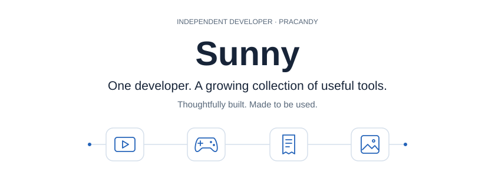

  <picture>
    <source media="(prefers-color-scheme: dark)" srcset="assets/studio-dark.svg" />
    
  </picture>

  <a href="https://pracandy.com"><strong>Explore Pracandy</strong></a>
  &nbsp; · &nbsp;
  <a href="https://sunny-kishor-singh.vercel.app/"><strong>Portfolio</strong></a>

 

<h2 align="center">The product shelf</h2>

Tools for creating, working, and making everyday life a little easier.

<table align="center">
<tr>
<td align="center" valign="middle" width="170" height="140">
   
  
   <strong><a href="https://fresta.pracandy.com">Fresta</a></strong>
   YouTube Shorts
    
</td>
<td align="center" valign="middle" width="170" height="140">
   
  
   <strong><a href="https://gamingcap.pracandy.com">GamingCap</a></strong>
   Gameplay montages
    
</td>
<td align="center" valign="middle" width="170" height="140">
   
  
   <strong><a href="https://instalaz.pracandy.com">Instalaz</a></strong>
   Instagram scheduling
    
</td>
<td align="center" valign="middle" width="170" height="140">
   
  
   <strong><a href="https://invoice.pracandy.com">Invoiceful</a></strong>
   Business invoices
    
</td>
</tr>
<tr>
<td align="center" valign="middle" width="170" height="140">
   
  
   <strong><a href="https://walls.pracandy.com">PracandyWalls</a></strong>
   Android wallpapers
    
</td>
<td align="center" valign="middle" width="170" height="140">
   
  
   <strong><a href="https://anyway.pracandy.com">Anyway</a></strong>
   Student planner
    
</td>
<td align="center" valign="middle" width="170" height="140">
   
  
   <strong><a href="https://flix.pracandy.com">PracandyFlix</a></strong>
   Movie &amp; show guides
    
</td>
<td align="center" valign="middle" width="170" height="140">
   
  
   <strong><a href="https://pracandy.com">Pracandy</a></strong>
   My indie studio
    
</td>
</tr>
</table>

 

<strong>Built with</strong>

JavaScript &nbsp; · &nbsp; TypeScript &nbsp; · &nbsp; React &nbsp; · &nbsp; Next.js &nbsp; · &nbsp; Node.js

<strong>Open-source contributions</strong>

  

Ship beats perfect. Build, learn, improve.

